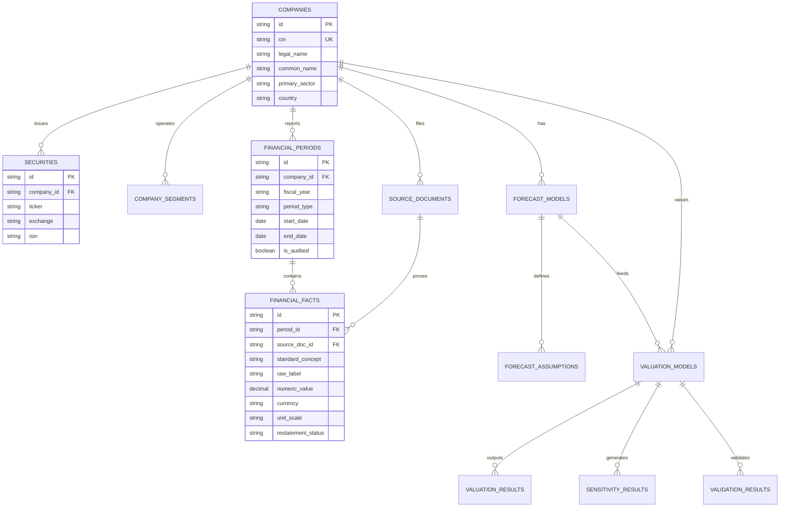

# SYSTEM ARCHITECTURE & INTEGRATION SPECIFICATION
## Universal Multi-Company Financial Valuation & DCF Engine

---

## 1. System Architectural Overview

The Universal Valuation Engine is designed as a decoupled, modular, enterprise-grade financial engineering platform:

```
┌────────────────────────────────────────────────────────────────────────┐
│                        FRONTEND CLIENT LAYER                           │
│  Next.js / React / TypeScript / Tailwind CSS Institutional Portal       │
│  - Financial Statement Tables   - Interactive Scenario Toggles         │
│  - 2D Sensitivity Heatmaps      - Real-time Valuation Bridges          │
└───────────────────────────────────┬────────────────────────────────────┘
                                    │ REST / JSON (HTTP/2)
                                    ▼
┌────────────────────────────────────────────────────────────────────────┐
│                        BACKEND API LAYER (FastAPI)                     │
│  - Versioned Endpoints (/api/v1) - Pydantic Validation & Serialization │
│  - Dependency Injection         - CORS & Security Middleware           │
└───────────────────────────────────┬────────────────────────────────────┘
                                    │
    ┌───────────────────────────────┴────────────────────────────────┐
    │                                                                │
    ▼                                                                ▼
┌─────────────────────────────────────────┐  ┌─────────────────────────────────────────┐
│       FINANCIAL ENGINEERING ENGINE      │  │        DATA INGESTION & PIPELINE        │
│  - Core Formula Engine (NOPAT, WACC)    │  │  - XBRL/XML Parser                      │
│  - Universal Accounting Dictionary      │  │  - PDF Tabular Extractor                │
│  - 21 Sector-Specific Modules (Registry)│  │  - CSV / Excel Importers                │
│  - Dual-DCF, DDM, NAV, SOTP, Comps      │  │  - Provenance & Metadata Tracker        │
│  - Dynamic Three-Statement Forecaster   │  │  - Accounting Normaliser & Ind AS 116   │
└───────────────────┬─────────────────────┘  └────────────────────┬────────────────────┘
                    │                                             │
                    └──────────────────────┬──────────────────────┘
                                           │
                                           ▼
┌────────────────────────────────────────────────────────────────────────┐
│                        DATA PERSISTENCE LAYER                          │
│  SQLAlchemy 2.0 ORM with 15 Relational Entities                        │
│  - SQLite (ACID Local Embedded Engine) / PostgreSQL (Cloud Production)  │
│  - Companies, Securities, Facts, Assumptions, Models, Valuations       │
└────────────────────────────────────────────────────────────────────────┘
```

---

## 2. Database Entity Relationship Architecture (15 Core Entities)



---

## 3. Universal Module Interfaces

Every sector-specific valuation engine implements a strict interface contract (`ISectorEngine`):

```python
class ISectorEngine(ABC):
    @abstractmethod
    def get_operating_drivers(self) -> List[DriverDefinition]:
        """Returns standard operational drivers for the sector."""
        pass

    @abstractmethod
    def forecast_statements(self, historicals: FinancialDataset, assumptions: ScenarioAssumptions) -> ForecastOutput:
        """Projects integrated 5-year financial statements."""
        pass

    @abstractmethod
    def select_valuation_methodologies(self) -> List[ValuationMethod]:
        """Returns ordered list of applicable valuation techniques."""
        pass

    @abstractmethod
    def compute_valuation(self, forecast: ForecastOutput, wacc: CostOfCapital) -> ValuationOutput:
        """Executes sector-appropriate valuation (e.g. DDM for Banks, SOTP for Holding Co)."""
        pass
```

This ensures zero coupling between the API layer and the individual mathematical models.
