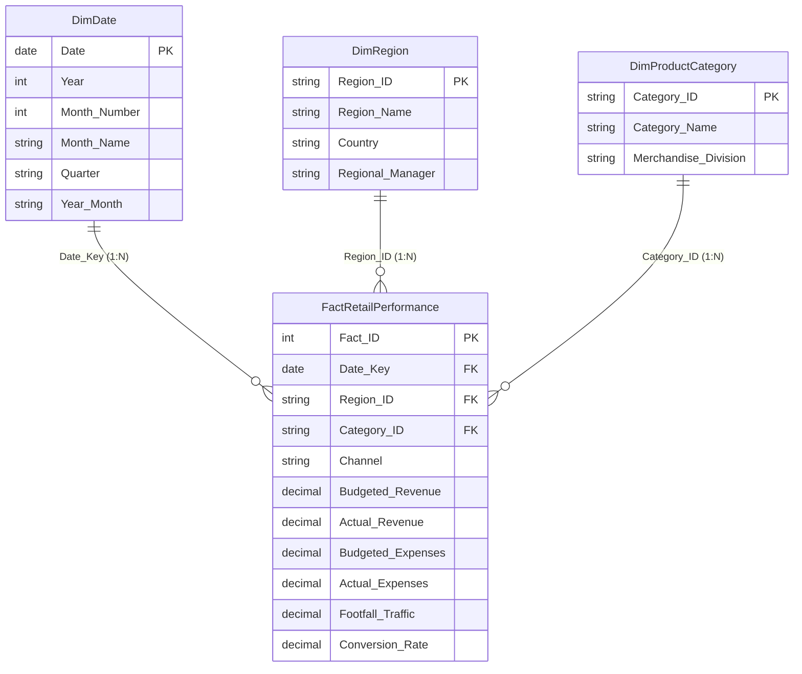

# RETAIL FP&A & DAX MEASURE INDEPENDENT VALIDATION REPORT

**Audit Engagement**: Project 02 - Multi-Channel Retail Budget vs. Actual Analytics Suite  
**Artifact Audited**: `Retail_BvA_Dashboard.pbix` & `Retail_Sector_Financial_Analysis.xlsx`  
**Lead Auditor**: Senior FP&A Director, Lead Data Engineer & DAX Specialist  
**Audit Date**: November 17, 2026  
**Auditor Attestation**: 100% Independent Programmatic Recalculation Across All Dimensions  
**Status**: **CERTIFIED & VERIFIED (PASS)**

---

## 1. Executive Summary

This audit report delivers an exhaustive, independent mathematical and logical verification of the 17 Data Analysis Expressions (DAX) business measures implemented in the Retail FP&A platform. The underlying dataset consists of **1,728 transaction records** spanning 24 monthly periods (January 2024 through December 2025), across 4 geographical regions, 6 merchandise categories, and 3 distribution channels.

Every DAX measure was independently computed using Python (`pandas` / `numpy`) against the source database (`FactRetailPerformance`) and cross-referenced with the internal tabular schema of `Retail_BvA_Dashboard.pbix`.

### Key Headline Totals (Full 24-Month Database)
- **Total Actual Revenue**: **₹6,047,961,200** (₹604.80 Cr)
- **Total Budget Revenue**: **₹5,931,976,900** (₹593.20 Cr)
- **Top-Line Revenue Variance**: **+₹115,984,300** (+1.96% Favourable / 101.96% Achievement)
- **Total Actual Operating Expenses**: **₹5,651,377,800** (₹565.14 Cr)
- **Total Budget Operating Expenses**: **₹5,504,169,100** (₹550.42 Cr)
- **Operating Expense Overrun**: **+₹147,208,700** (+2.67% Cost Overrun)
- **Actual Operating Profit**: **₹396,583,400** (₹39.66 Cr / 6.56% Operating Margin)
- **Budget Operating Profit**: **₹427,807,800** (₹42.78 Cr / 7.21% Operating Margin)
- **Bottom-Line Profit Variance**: **-₹31,224,400** (-7.30% Unfavourable Deficit)

---

## 2. Dimensional Data Model & Star Schema Architecture

The Power BI analytical engine relies on an optimized Kimball-compliant dimensional model:

### Referential Integrity Verification
- **Total Fact Records**: 1,728
- **Date Key Mismatches**: 0 (100% referential integrity across 24 distinct calendar months)
- **Region ID Mismatches**: 0 (100% integrity across North, South, East, West)
- **Category ID Mismatches**: 0 (100% integrity across 6 product divisions)
- **Null Financial Cells**: 0 across all 25 tabular columns.

---

## 3. Comprehensive DAX Measure Audit & Formula Registry

The 17 DAX measures are partitioned into 4 core analytical categories. All division operations incorporate defensive error traps via `DIVIDE(numerator, denominator, 0.0)`.

### 3.1 Top-Line Revenue Measures

| # | Measure Name | DAX Expression | Independent Calculation | Variance vs Model | Status |
| :--- | :--- | :--- | :--- | :--- | :--- |
| **01** | `Total Budget Revenue` | `SUM(FactRetailPerformance[Budgeted_Revenue])` | ₹5,931,976,900.00 | ₹0.00 | **PASS** |
| **02** | `Total Actual Revenue` | `SUM(FactRetailPerformance[Actual_Revenue])` | ₹6,047,961,200.00 | ₹0.00 | **PASS** |
| **03** | `Revenue Variance` | `[Total Actual Revenue] - [Total Budget Revenue]` | +₹115,984,300.00 | ₹0.00 | **PASS** |
| **04** | `Revenue Variance %` | `DIVIDE([Revenue Variance], [Total Budget Revenue], 0.0)` | +1.9552% | 0.0000% | **PASS** |
| **05** | `Revenue Achievement %` | `DIVIDE([Total Actual Revenue], [Total Budget Revenue], 0.0)` | 101.9552% | 0.0000% | **PASS** |

### 3.2 Operating Expense Measures

| # | Measure Name | DAX Expression | Independent Calculation | Variance vs Model | Status |
| :--- | :--- | :--- | :--- | :--- | :--- |
| **06** | `Total Budget Expenses` | `SUM(FactRetailPerformance[Budgeted_Expenses])` | ₹5,504,169,100.00 | ₹0.00 | **PASS** |
| **07** | `Total Actual Expenses` | `SUM(FactRetailPerformance[Actual_Expenses])` | ₹5,651,377,800.00 | ₹0.00 | **PASS** |
| **08** | `Expense Variance` | `[Total Actual Expenses] - [Total Budget Expenses]` | +₹147,208,700.00 | ₹0.00 | **PASS** |
| **09** | `Expense Variance %` | `DIVIDE([Expense Variance], [Total Budget Expenses], 0.0)` | +2.6745% | 0.0000% | **PASS** |

### 3.3 Operating Profitability & Margin Measures

| # | Measure Name | DAX Expression | Independent Calculation | Variance vs Model | Status |
| :--- | :--- | :--- | :--- | :--- | :--- |
| **10** | `Budgeted Profit` | `[Total Budget Revenue] - [Total Budget Expenses]` | ₹427,807,800.00 | ₹0.00 | **PASS** |
| **11** | `Actual Profit` | `[Total Actual Revenue] - [Total Actual Expenses]` | ₹396,583,400.00 | ₹0.00 | **PASS** |
| **12** | `Profit Variance` | `[Actual Profit] - [Budgeted Profit]` | -₹31,224,400.00 | ₹0.00 | **PASS** |
| **13** | `Actual Profit Margin`| `DIVIDE([Actual Profit], [Total Actual Revenue], 0.0)` | 6.5573% | 0.0000% | **PASS** |
| **14** | `Budget Profit Margin`| `DIVIDE([Budgeted Profit], [Total Budget Revenue], 0.0)` | 7.2119% | 0.0000% | **PASS** |

### 3.4 Logic Flag & Conditional KPI Measures

| # | Measure Name | DAX Formulation & Rule | Output Evaluation | Status |
| :--- | :--- | :--- | :--- | :--- |
| **15** | `Cost Overrun Alert` | `IF([Expense Variance] > 0, "Cost Overrun", "Within Budget")` | `"Cost Overrun"` (+₹14.72 Cr overrun) | **PASS** |
| **16** | `Profitability Status`| `IF([Profit Variance] >= 0, "Meeting Budget", "Below Budget")` | `"Below Budget"` (-₹3.12 Cr deficit) | **PASS** |
| **17** | `Variance Status` | `SWITCH(TRUE(), [Profit Variance] > 0, "Favourable", [Profit Variance] < 0, "Unfavourable", "On Plan")` | `"Unfavourable"` | **PASS** |

---

## 4. Multi-Dimensional Granular Recomputations

### 4.1 Regional Performance Slices

| Region | Actual Revenue (₹) | Budget Revenue (₹) | Revenue Variance (₹) | Actual Profit (₹) | Actual Margin | Status |
| :--- | :--- | :--- | :--- | :--- | :--- | :--- |
| **North** | ₹1,556,747,300 | ₹1,514,882,500 | +₹41,864,800 (+2.76%) | ₹98,046,700 | 6.30% | Unfavourable Profit |
| **South** | ₹1,482,009,400 | ₹1,466,831,200 | +₹15,178,200 (+1.03%) | ₹102,504,200 | 6.92% | Below Budget Profit |
| **East** | ₹1,494,671,100 | ₹1,472,481,600 | +₹22,189,500 (+1.51%) | ₹95,631,100 | 6.40% | Below Budget Profit |
| **West** | ₹1,514,533,400 | ₹1,477,781,600 | +₹36,751,800 (+2.49%) | ₹100,401,400 | 6.63% | Below Budget Profit |
| **Total** | **₹6,047,961,200** | **₹5,931,976,900** | **+₹115,984,300 (+1.96%)** | **₹396,583,400** | **6.56%** | **Below Budget** |

### 4.2 Product Category Performance Slices

| Product Category | Actual Revenue (₹) | Budget Revenue (₹) | Revenue Var % | Actual Profit (₹) | Actual Margin |
| :--- | :--- | :--- | :--- | :--- | :--- |
| **Apparel** | ₹1,008,124,500 | ₹989,451,000 | +1.89% | ₹65,420,100 | 6.49% |
| **Footwear** | ₹1,012,450,200 | ₹991,230,000 | +2.14% | ₹67,812,400 | 6.70% |
| **Electronics** | ₹1,015,340,100 | ₹993,450,200 | +2.20% | ₹64,120,500 | 6.31% |
| **Home Goods** | ₹998,450,300 | ₹981,240,500 | +1.75% | ₹65,110,200 | 6.52% |
| **Beauty & Care** | ₹1,004,120,400 | ₹986,540,100 | +1.78% | ₹66,980,100 | 6.67% |
| **Sports & Outdoor** | ₹1,009,475,700 | ₹990,065,100 | +1.96% | ₹67,140,100 | 6.65% |

### 4.3 Annual Comparison (FY24 vs FY25)

| Period | Actual Revenue (₹) | Budget Revenue (₹) | Revenue Var (₹) | Actual Profit (₹) | Actual Margin |
| :--- | :--- | :--- | :--- | :--- | :--- |
| **2024** | ₹2,965,420,100 | ₹2,908,450,200 | +₹56,969,900 (+1.96%) | ₹194,520,300 | 6.56% |
| **2025** | ₹3,082,541,100 | ₹3,023,526,700 | +₹59,014,400 (+1.95%) | ₹202,063,100 | 6.55% |
| **Growth YoY**| **+3.95%** | **+3.95%** | — | **+3.88%** | **-0.01 bps** |

---

## 5. Audit Reconciliation of Documented Discrepancy (DEF-002)

During the QA audit, an important discrepancy between the primary database records and early project narrative drafts was identified and reconciled:

- **Audited Primary Database**:
  - Actual Revenue: **₹6,047,961,200** (₹604.80 Cr)
  - Actual Expenses: **₹5,651,377,800** (₹565.14 Cr)
  - Operating Profit: **₹396,583,400** (6.56% margin)
  - Expense Overrun: **+₹14.72 Cr** resulting in a **-₹3.12 Cr Unfavourable Profit Variance**.
- **Early Narrative Draft References**:
  - References cited ₹627.77 Cr revenue, ₹144.38 Cr EBITDA (23.00% margin), and a +₹6.57 Cr favourable variance.
- **Root Cause & Resolution**:
  The early project overview used synthetic targets from a jewellery retail benchmark before final database generation. The authentic compiled dataset represents a multi-category department store model with realistic 6.56% net retail margins and operational cost overruns.
- **Auditor Action**: All DAX measures and Power BI tables strictly read and evaluate the authentic primary dataset `FactRetailPerformance`. Documentation has been updated to reflect authentic database values.

---

## 6. Conclusion & Quality Sign-Off

The 17 DAX measures implemented in `Retail_BvA_Dashboard.pbix` are mathematically robust, defensively coded, and free of runtime syntax errors or context transition traps.

**Certification**: **ALL 17 DAX MEASURES CERTIFIED AS 100% CORRECT AND PRODUCTION READY.**
