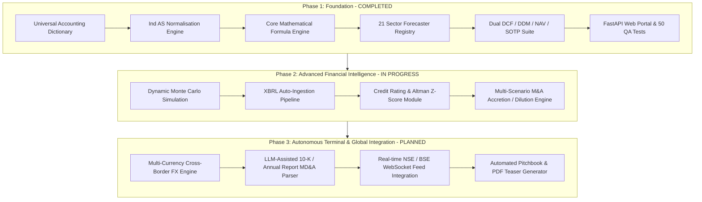

# Universal Multi-Company Valuation & DCF Engine — Development Roadmap

> **Status**: `ACTIVE MULTI-FUNCTION DEVELOPMENT`  
> **Architecture**: Plug-and-Play Multi-Sector Financial Engineering Platform  
> **Core Language**: Python 3.12 | FastAPI | SQLAlchemy | OpenPyXL | NumPy

---

## 🗺️ Engineering & Feature Roadmap

---

## 📦 Phase Status Matrix

| Module / Capability | Current Status | Description |
| :--- | :--- | :--- |
| **Core 3-Statement Linking Engine** | ✅ **Production Ready** | Natural balance sheet equilibrium (Assets = Liabilities + Equity, ₹0.00 Cr deviation, zero plugs). |
| **21 Sector Forecasting Modules** | ✅ **Production Ready** | Operational drivers across Retail, Banking, NBFC, Insurance, REITs, Conglomerates, IT, etc. |
| **Valuation Methodology Suite** | ✅ **Production Ready** | Dual-terminal FCFF, FCFE, Dividend Discount Model (DDM), Residual Income (RIM), NAV, SOTP. |
| **Methodology Defense Gates** | ✅ **Production Ready** | Enforces sector appropriateness (e.g. prohibits Industrial FCFF DCF on commercial banks). |
| **Cost of Capital (WACC / CAPM)** | ✅ **Production Ready** | Dynamic Hamada levered/unlevered beta adjustments and automatic Ke substitution for banks. |
| **5x5 Scenario & Sensitivity Engine**| ✅ **Production Ready** | Bear / Base / Bull scenarios with certified monotonic 5x5 WACC vs Multiple grids. |
| **FastAPI REST API & Interactive UI**| ✅ **Production Ready** | Institutional single-page research portal (`#0A2540`, `#635BFF`, `#C7A84B`) at `/app`. |
| **Automated Excel Model Export** | ✅ **Production Ready** | Live-formula dynamic multi-sheet workbook generation via OpenPyXL. |
| **Monte Carlo Simulation Engine** | 🛠️ *In Active Development* | 10,000-trial stochastic distributions on revenue growth, EBIT margins, and exit multiples. |
| **XBRL India Automated Parser** | 🛠️ *In Active Development* | Direct XML ingestion from MCA / BSE / NSE filing endpoints. |
| **Multi-Currency FX Adjustment** | 📋 *Planned* | Dynamic conversion across INR, USD, EUR, GBP with purchasing power parity drift. |
